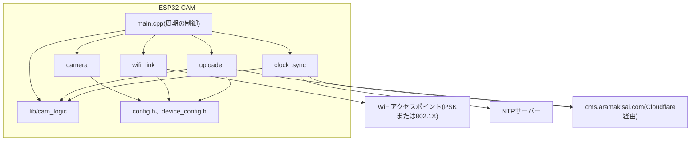
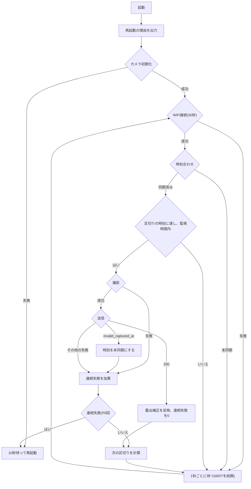
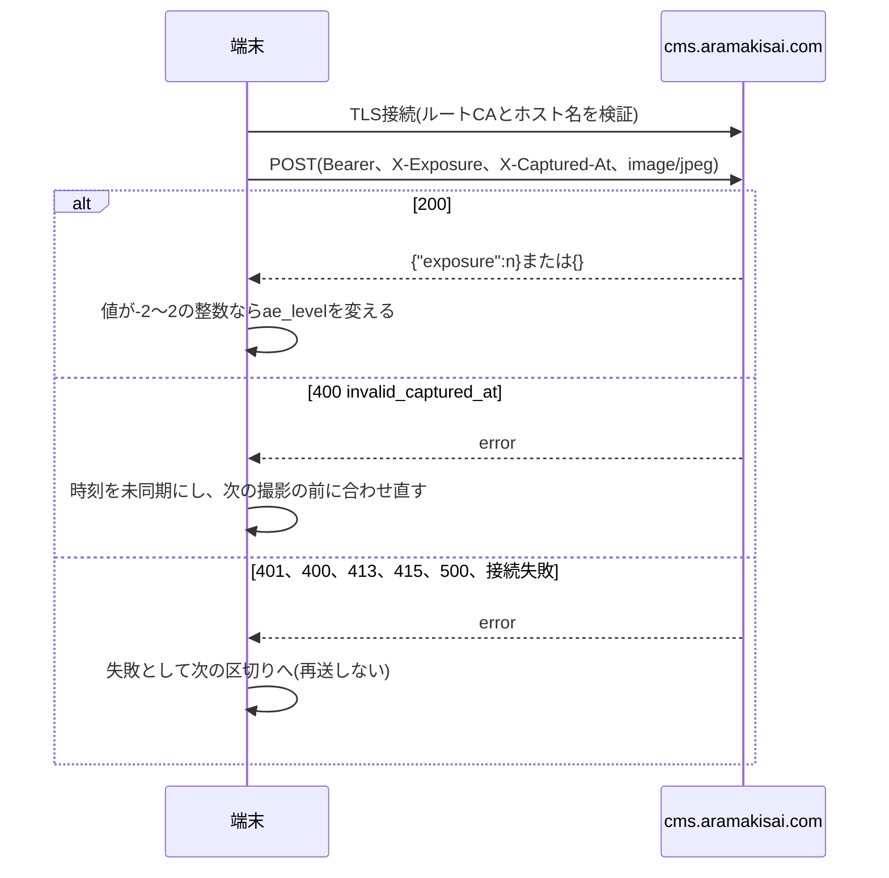

# Design Document

## Overview
**Purpose**: 荒牧祭の駐車場を、監視時間内(既定は日本時間9:00〜17:30)の5分の区切りごとに撮影し、JPEGをCMSの受信エンドポイントへHTTPSで送り続けるESP32-CAMのファームウェアを提供する。

**Users**: 実行委員が設置前に設定を書き込み、シリアル出力で動作を確かめてから、手の届きにくい場所に設置する。設置後は人の操作なしで動く。

**Impact**: 新規のリポジトリ。試作ファームの撮影設定と実測値を引き継ぐ。

### Goals
- 監視時間内の区切りの時刻(9:00、9:05、…、17:30)に撮影し、撮影時刻・露出補正値・トークンを付けて送る
- WiFi・時刻・送信・カメラのどこで失敗しても次の区切りで再試行し、固まったらウォッチドッグで再起動する

### Non-Goals
- 遠隔からの設定変更・ファームウェア更新(OTA)
- 証明書の有効期間の確認(Security Considerations参照)
- 802.1Xの認証サーバー名の照合(同上)
- フラッシュ暗号化。秘密値はフラッシュに平文で残る(同上)
- 省電力化。監視時間外もWiFiと時刻を保ち、待つだけにする

## Boundary Commitments

### This Spec Owns
- 端末のファームウェア(`src/`、`lib/`、`test/`)、ビルド構成(`platformio.ini`)、設定の雛形
- 端末の書込み手順と設置前の確認手順
- 送信のリクエストの組み立てと、応答の解釈

### Out of Boundary
- 受信エンドポイントの検証・保存・判定・露出補正値の決め方(`aramakisai-web`の`parking-camera-endpoint`)
- トークンの発行と、駐車場への割り当て
- 監視時間外の画像を受信側が判定しない処理

### Allowed Dependencies
- Arduino core for ESP32 2.0.17と同梱のesp32-camera、`WiFiClientSecure`、`HTTPClient`、lwIPのSNTP
- 受信エンドポイント`POST /api/parking-ingest`の取り決め(下記API Contract)
- `lib/`はC++標準ライブラリだけに依存する

### Revalidation Triggers
- 受信エンドポイントのヘッダー・応答コード・応答本文の形の変更
- `X-Captured-At`の許容範囲(受信時刻の2分先〜10分前)の変更
- 受信側の監視時間(`site_settings`の`parking_monitor`、既定9:00〜17:30、両端を含む)の変更。端末の`MONITOR_START_MIN`・`MONITOR_END_MIN`を合わせて書き直す
- CloudflareのUniversal SSLの発行元の追加
- 設置先の802.1Xの認証サーバーのルートCAの変更

## Architecture

### Architecture Pattern & Boundary Map



**Architecture Integration**:
- Selected pattern: `loop()`が1周期を順に実行する単一ループ。各段階は結果を戻り値で返し、判断は`lib/`の純粋関数に任せる
- Dependency direction: `lib/cam_logic` → `include/config.h` → `src/`の各モジュール(`camera`、`wifi_link`、`clock_sync`、`uploader`)→ `src/main.cpp`。`lib/`はArduino・ESP-IDFのヘッダーを読み込まない。`src/`のモジュール同士は呼び合わず、`main.cpp`だけが組み合わせる
- Steering compliance: 失敗は戻り値で返して次周期へ進む。設定値は`config.h`に集める。秘密値はシリアルに出さない

### Technology Stack

| Layer | Choice / Version | Role in Feature | Notes |
|-------|------------------|-----------------|-------|
| ビルド | PlatformIO Core 6.2.0、`platform = espressif32` 7.1.3、`framework = arduino` | 試作と同じ構成 | 事前ビルドのライブラリとブートローダーを使う |
| フレームワーク | Arduino core for ESP32 2.0.17(ESP-IDF 4.4.7上) | WiFi、TLS、HTTP、SNTP | sdkconfigは同梱のまま変えない |
| カメラ | esp32-camera(Arduino core同梱) | OV2640の撮影 | |
| TLS | mbedTLS 2.28(IDF同梱) | HTTPSと802.1X | TLS 1.2。期限の判定なし |
| テスト | `platform = native`、Unity | `lib/`の単体テスト | `pio test -e native` |
| 書込み | `pio run -t upload`(esptool) | 書込みと書き直し | CH340の自動リセットで書ける |

## File Structure Plan

### Directory Structure
```
platformio.ini                 # env:esp32camとenv:native
include/
├── config.h                   # 既定値の補完とstatic_assertによる検証。device_config.hを読み込む
├── device_config.example.h    # 雛形(コミットする)
├── device_config.h            # 実値(.gitignoreの対象)
├── cms_root_ca.h              # 送信先のルートCA(公開情報、コミットする)
└── eap_ca_gunet.h             # GunetEAPの認証サーバーのルートCA(公開情報、コミットする)
lib/cam_logic/src/
├── config_check.h             # constexprの設定検証
├── schedule.h / .cpp          # 監視時間と区切りの時刻の計算
├── ingest_response.h / .cpp   # 応答の解釈
├── http_date.h / .cpp         # Dateヘッダーの解釈
└── failure_policy.h           # 連続失敗の計数と再起動の判断
src/
├── main.cpp                   # setup()/loop()、周期の制御、ウォッチドッグ
├── camera.h / .cpp            # 初期化、捨てフレーム、撮影、露出補正
├── wifi_link.h / .cpp         # PSK/802.1Xの接続と再接続
├── clock_sync.h / .cpp        # SNTPとDateによる時刻合わせ
└── uploader.h / .cpp          # HTTPS POST
test/
├── test_config_check/
├── test_schedule/
├── test_ingest_response/
├── test_http_date/
└── test_failure_policy/
README.md                      # 設定の書き方、書込み手順、設置前の確認
```

### Modified Files
- `.gitignore` — `include/device_config.h`を追加する

### ビルド構成
`platformio.ini`の`env:esp32cam`は`board = esp32cam`(パーティションはボード既定の`huge_app.csv`)、`monitor_speed = 115200`、`build_flags = -DBOARD_HAS_PSRAM -mfix-esp32-psram-cache-issue -DCORE_DEBUG_LEVEL=1`(Arduinoのログはエラーだけ)。`env:native`は`platform = native`、`test_framework = unity`、`lib_compat_mode = off`。

## System Flows

### 周期の流れ



- 待ちの間は1秒ごとにWiFiの接続を確かめ、切れていれば再接続を試みる(1回30秒、失敗したら60秒あけて再試行)。監視時間外も同じで、WiFiと時刻を保つ
- 起動して時刻が合った時点で監視時間内なら、区切りを待たずに1枚目を撮る(設置時の確認のため)。以降は区切りの時刻に撮る
- 連続失敗は撮影を試みた周期だけを数える。監視時間外の待ちと、時刻が合うまでの待ちは数えない

### 送信のシーケンス



## Requirements Traceability

| Requirement | Summary | Components | Interfaces | Flows |
|-------------|---------|------------|------------|-------|
| 1.1, 1.3, 1.7 | 監視時間内の区切りで撮影、起動直後の1枚目 | Schedule、main | `nextSlot`、`inWindow` | 周期の流れ |
| 1.2 | 既定5分 | Config | `CAPTURE_INTERVAL_SEC` | — |
| 1.4 | UXGAのJPEG | Camera | `cameraInit` | — |
| 1.5 | 捨てフレーム | Camera | `cameraInit`、`cameraCapture` | — |
| 1.6 | 撮影失敗で送らない | main、FailurePolicy | `CaptureResult` | 周期の流れ |
| 2.1, 2.2, 2.3 | 反転は設定、回転は設置で | Camera、Config | `IMAGE_VFLIP`、`IMAGE_HMIRROR` | — |
| 3.1, 3.2, 3.6 | HTTPS POST、トークン、撮影時刻、露出補正値 | Uploader | API Contract | 送信のシーケンス |
| 3.7 | 端末の状態を送信に付ける | Uploader、main | `DeviceStatus` | 送信のシーケンス |
| 3.3 | サーバー証明書の検証 | Uploader | `cms_root_ca.h` | 送信のシーケンス |
| 3.4 | 1撮影1枚 | main | — | 周期の流れ |
| 3.5 | 200以外は失敗 | IngestResponse | `parseIngestResponse` | 送信のシーケンス |
| 4.1, 4.2, 4.5, 4.12 | 書込み時の設定と既定値 | Config | `device_config.h` | — |
| 4.3, 4.4, 4.13 | 欠け・不正値をビルド時に拒否 | ConfigCheck | `static_assert` | — |
| 4.6〜4.11 | PSK/802.1X、PEAP/TTLS、CA証明書 | WifiLink | `wifiConnect` | — |
| 5.1, 5.2 | 雛形とgitignore | Config | `device_config.example.h` | — |
| 5.3 | シリアルに秘密値を出さない | 全モジュール | Monitoring | — |
| 5.4 | HTTPS以外は送らない | ConfigCheck、Uploader | `isHttpsUrl` | — |
| 6.1, 6.3 | WiFiの再接続と上限時間 | WifiLink、main | `wifiConnect` | 周期の流れ |
| 6.2, 6.7 | 再送しない、試行を続ける | main、FailurePolicy | — | 周期の流れ |
| 6.4 | ウォッチドッグ | main | TWDT 90秒 | — |
| 6.5 | カメラ初期化失敗で再起動 | main、Camera | — | 周期の流れ |
| 6.6 | 再起動後の再開 | main | — | 周期の流れ |
| 7.1〜7.3 | シリアル出力 | 全モジュール | Monitoring | — |
| 8.1〜8.5 | 露出補正の反映 | IngestResponse、Camera | `parseIngestResponse`、`cameraSetExposure` | 送信のシーケンス |
| 8.6 | AWB自動、レンズ補正 | Camera | `cameraInit` | — |
| 9.1〜9.4 | 時刻合わせ、合うまで撮らない、合わせ直し | ClockSync、HttpDate、main | `clockSync` | 周期の流れ |

## Components and Interfaces

| Component | Domain/Layer | Intent | Req Coverage | Key Dependencies | Contracts |
|-----------|--------------|--------|--------------|------------------|-----------|
| ConfigCheck | lib | 設定値のビルド時検証 | 4.3, 4.4, 4.13, 5.4 | — | Service |
| Schedule | lib | 区切りの時刻と監視時間 | 1.1, 1.3, 1.7 | — | Service |
| IngestResponse | lib | 応答の分類と露出補正値の取り出し | 3.5, 8.1〜8.4, 9.4 | — | Service |
| HttpDate | lib | `Date`ヘッダーをUnix秒に | 9.1 | — | Service |
| FailurePolicy | lib | 連続失敗で再起動 | 6.7 | — | State |
| Config | include | 設定値を1箇所に集める | 4.1, 4.2, 4.5, 4.12, 5.1, 5.2 | ConfigCheck (P0) | — |
| Camera | src | 撮影と露出補正 | 1.4, 1.5, 2.1〜2.3, 8.1, 8.6 | esp32-camera (P0) | Service |
| WifiLink | src | WiFi接続 | 4.6〜4.11, 6.1, 6.3 | Arduino WiFi (P0) | Service |
| ClockSync | src | 時刻合わせ | 9.1〜9.4 | lwIP SNTP (P0)、HttpDate (P1) | Service、State |
| Uploader | src | HTTPS POST | 3.1〜3.3, 3.6, 3.7, 5.4 | WiFiClientSecure (P0)、IngestResponse (P0) | API |
| main | src | 周期の制御と回復 | 1.1, 1.6, 3.4, 6.2〜6.7, 7.1〜7.3 | 上記すべて (P0) | State |

### lib(ハードウェア非依存)

#### ConfigCheck

| Field | Detail |
|-------|--------|
| Intent | 設定値の欠け・不正を`static_assert`でビルド時に止める |
| Requirements | 4.3, 4.4, 4.13, 5.4 |

```cpp
// C++11のconstexpr(単一のreturn)で書く
constexpr bool isNonEmpty(const char* s);
constexpr bool isHttpsUrl(const char* url);              // "https://"で始まり、ホスト名がある
constexpr bool isValidInterval(long sec);                // 60 <= sec <= 3600、3600 % sec == 0
constexpr bool isValidWindow(int startMin, int endMin);  // 0 <= start < end <= 1439
constexpr bool isValidExposure(long v);                  // -2 <= v <= 2
```
- `config.h`は`WIFI_AUTH`に応じて必要な値(PSKは`WIFI_PASSWORD`、802.1Xは`EAP_USERNAME`と`EAP_PASSWORD`)の`isNonEmpty`を検証する
- 撮影間隔の下限60秒は、撮影と送信が1周期に収まる長さ。1時間を割り切る値に限るのは、区切りを毎時0分に揃えるため

#### Schedule

| Field | Detail |
|-------|--------|
| Intent | 監視時間内の次の区切りの時刻を求める |
| Requirements | 1.1, 1.3, 1.7 |

```cpp
struct Window { int startMin; int endMin; };   // 日本時間の0時からの分。両端を含む
constexpr long JST_OFFSET_SEC = 9 * 3600;

// from以上で、監視時間内にある最初の区切りの時刻(Unix秒)。区切りは日本時間でintervalの倍数
int64_t nextSlot(int64_t from, long intervalSec, Window w);
bool inWindow(int64_t t, Window w);
```
- 区切りは`(t + JST_OFFSET_SEC) % intervalSec == 0`の時刻。`intervalSec`が3600の約数のため、日本時間の毎時0分を含む
- 17:30の区切りは含み、17:31以降は翌日の`startMin`の区切りを返す
- `main`は撮影後に`nextSlot(slot + 1, …)`で次を求める。送信が長引いて区切りを過ぎた場合は、過ぎた区切りを飛ばしてその次を返す(過去の区切りで撮らない)

#### IngestResponse

| Field | Detail |
|-------|--------|
| Intent | 応答コードと本文から結果を分類する |
| Requirements | 3.5, 8.1〜8.4, 9.4 |

```cpp
enum class IngestOutcome {
  Ok, InvalidCapturedAt, InvalidExposure, Unauthorized, TooLarge, NotJpeg, ServerError, UnexpectedStatus
};
struct IngestResult {
  IngestOutcome outcome;
  bool hasExposure;   // Okのときだけ意味を持つ
  int exposure;       // -2〜2
};
IngestResult parseIngestResponse(int status, const char* body, size_t len);
```
- 200: 本文から`"exposure"`の値を読む。値が-2〜2の整数でない(小数・範囲外・文字列・`null`)ときや、本文がJSONのオブジェクトとして読めないときは`hasExposure = false`(8.3)。キーが無ければ`hasExposure = false`(8.4)
- 400: 本文に`"invalid_captured_at"`を含めば`InvalidCapturedAt`、それ以外は`InvalidExposure`
- 401・413・415・5xxはそれぞれの値、それ以外は`UnexpectedStatus`
- JSONの解釈は、`{`・`}`・空白・`"exposure"`・`:`・整数だけを扱う最小のもので、外部ライブラリを使わない

#### HttpDate

```cpp
// "Wed, 21 Oct 2026 07:28:00 GMT"(IMF-fixdate)をUnix秒に。読めなければfalse
bool parseHttpDate(const char* s, int64_t* out);
```

#### FailurePolicy

```cpp
constexpr int MAX_CONSECUTIVE_FAILURES = 6;   // 5分間隔で30分
struct FailurePolicy {
  int consecutive = 0;
  void onSuccess();            // consecutiveを0にする
  bool onFailureShouldRestart(); // 加算し、MAXに達したらtrue
};
```
- 再起動はWiFiドライバーやカメラが戻らない状態からの回復のため。再起動後も周期を続けるので、6.7の「止めない」と両立する

### include

#### Config
- `device_config.h`はマクロで値を与える。`config.h`は`#ifndef`で既定値を補い、ConfigCheckで検証する

| マクロ | 型 | 既定 | 必須 |
|---|---|---|---|
| `CMS_INGEST_URL` | 文字列 | — | ○ |
| `DEVICE_TOKEN` | 文字列 | — | ○ |
| `WIFI_AUTH` | `WIFI_AUTH_PSK`・`WIFI_AUTH_EAP_PEAP`・`WIFI_AUTH_EAP_TTLS` | — | ○ |
| `WIFI_SSID` | 文字列 | — | ○ |
| `WIFI_PASSWORD` | 文字列 | — | PSKのとき |
| `EAP_IDENTITY` | 文字列 | `""`(空ならユーザー名を使う) | — |
| `EAP_USERNAME`、`EAP_PASSWORD` | 文字列 | — | 802.1Xのとき |
| `EAP_CA_PEM` | 文字列(PEM、複数可) | 未定義(検証しない)。雛形はGunetEAP用の`GUNET_EAP_CA_PEM` | — |
| `CAPTURE_INTERVAL_SEC` | 整数 | 300 | — |
| `MONITOR_START_MIN`、`MONITOR_END_MIN` | 整数(日本時間の0時からの分) | 540(9:00)、1050(17:30) | — |
| `IMAGE_VFLIP`、`IMAGE_HMIRROR` | 0/1 | 0、0 | — |
| `EXPOSURE_DEFAULT` | 整数 | 0 | — |

- `device_config.example.h`は全項目を値を伏せて並べる。`device_config.h`が無いとビルドが止まる(`#include`の失敗)
- 秘密値はアプリの`.rodata`に平文で入る(Security Considerations)。NVSには書かない
- `eap_ca_gunet.h`(コミットする)はSECOM TLS RSA Root CA 2024(自己署名版、配布元`http://repo2.secomtrust.net/root/tlsrsa/tlsrsarootca2024.cer`、2049年まで)のPEMを`GUNET_EAP_CA_PEM`として持つ。GunetEAPの認証サーバーのチェーンは`rad.gunma-u.ac.jp`←NII Open Domain CA - G8 RSA←SECOM TLS RSA Root CA 2024で、サーバーはSecurity Communication RootCA2によるクロス証明書版を送る。実機ではSECOM TLS RSA Root CA 2024とSecurity Communication RootCA2のどちらでも接続でき、ISRG Root X1では接続できなかった
- `cms_root_ca.h`はISRG Root X1・ISRG Root X2・GTS Root R1・GTS Root R4・SSL.com Root Certification Authority ECC・SSL.com Root Certification Authority RSAのPEMを連結した1つの文字列

### src

#### Camera

| Field | Detail |
|-------|--------|
| Intent | OV2640を初期化し、送信用のフレームを取る |
| Requirements | 1.4, 1.5, 2.1〜2.3, 8.1, 8.6 |

```cpp
bool cameraInit(int exposure);           // 失敗でfalse(mainが再起動する)
camera_fb_t* cameraCapture();            // 失敗でnullptr。使い終えたらesp_camera_fb_returnする
void cameraSetExposure(int exposure);    // set_ae_level
```
- 初期化は試作と同じ設定(AI Thinkerのピン、XCLK 20MHz、`PIXFORMAT_JPEG`、`FRAMESIZE_UXGA`、`jpeg_quality=10`、`fb_count=1`、`CAMERA_FB_IN_PSRAM`、`CAMERA_GRAB_WHEN_EMPTY`)。続けて`set_whitebal(1)`・`set_awb_gain(1)`・`set_wb_mode(0)`・`set_lenc(1)`・`set_ae_level(exposure)`・`set_vflip`・`set_hmirror`を一度だけ設定し、以後AWB・WBは変えない
- 初期化の後、2秒待ってから5フレームを100ms間隔で捨てる(1.5)
- `cameraCapture`は、古いフレームを捨てるために3フレームを100ms間隔で捨ててから、`esp_camera_fb_get()`を500ms待ちで最大20回試す。それでも取れなければ失敗
- 露出補正は応答を受けた時点で`cameraSetExposure`を呼ぶ。次の撮影は早くても次の区切り(数分後)で、自動露出が落ち着く時間がある。設定直後の`fb_get`の失敗は上の再試行で吸収する
- フレームが1MiB(1,048,576バイト)を超えたら送らず、撮影失敗として扱う

#### WifiLink

| Field | Detail |
|-------|--------|
| Intent | 設定の接続方式でWiFiに接続する |
| Requirements | 4.6〜4.11, 6.1, 6.3 |

```cpp
enum class WifiResult { Connected, Timeout };
WifiResult wifiConnect(uint32_t timeoutMs);   // 接続済みなら即Connected
bool wifiIsConnected();
```
- 起動時に`WiFi.persistent(false)`・`WiFi.mode(WIFI_STA)`・`WiFi.setAutoReconnect(true)`。接続情報をNVSに書かない
- PSK: `WiFi.begin(WIFI_SSID, WIFI_PASSWORD)`
- 802.1X: 試行のたびに、次の順で呼ぶ(`<esp_wpa2.h>`)
  1. `esp_wifi_sta_wpa2_ent_disable()`、`esp_wifi_sta_wpa2_ent_clear_ca_cert()`・`clear_identity()`・`clear_username()`・`clear_password()`。`WiFi.begin`は前回のCA証明書を消さないため、毎回消してから設定する
  2. `EAP_CA_PEM`があれば`esp_wifi_sta_wpa2_ent_set_ca_cert((const unsigned char*)EAP_CA_PEM, strlen(EAP_CA_PEM) + 1)`。長さは終端のNULを含める。`WiFi.begin`の`ca_pem`に渡すとNULを含まない長さになり、どのCAでも接続に失敗する(実機で確認)
  3. TTLSのときは`esp_wifi_sta_wpa2_ent_set_ttls_phase2_method(ESP_EAP_TTLS_PHASE2_MSCHAPV2)`
  4. `WiFi.begin(WIFI_SSID, WPA2_AUTH_PEAP or WPA2_AUTH_TTLS, identity, EAP_USERNAME, EAP_PASSWORD, NULL)`。`identity`は`EAP_IDENTITY`が空なら`EAP_USERNAME`
- `EAP_CA_PEM`が未定義なら、起動時と接続のたびに`[warn] eap ca not set`を出す(4.11)
- 1回の試行は15秒で打ち切り、`WiFi.disconnect()`して1回だけ試し直す(`wifiConnect`全体で30秒)。GunetEAPでの接続は1.3〜8.5秒で、電源投入直後の最初の試行が15秒で失敗し、試し直しで成功することがあった。2回とも失敗したら`Timeout`を返し、次の試行は`main`が決める
- 802.1Xの証明書検証はCA証明書による署名の連鎖だけで、サーバー名は照合しない(Security Considerations)

#### ClockSync

| Field | Detail |
|-------|--------|
| Intent | 端末の時刻を合わせ、合っているかを保つ |
| Requirements | 9.1〜9.4 |

```cpp
enum class ClockSource { None, Sntp, HttpDate };
void clockBegin();                 // SNTPを開始(サーバーと周期を設定)
bool clockEnsure();                // 合っていればtrue。合っていなければ合わせを試みる
void clockInvalidate();            // invalid_captured_atを受けたとき
ClockSource clockSource();
```
- **State**: `synced`(起動時は偽)。真になる条件はSNTPの同期完了の通知(`sntp_set_time_sync_notification_cb`)か、`Date`での設定。偽にするのは`clockInvalidate`だけ。再起動で偽に戻る(RTCの電池が無い)
- SNTPは`configTime(0, 0, "ntp.nict.jp", "time.cloudflare.com", "pool.ntp.org")`。WiFi接続の後に始める(802.1Xでは接続前にネットワークが無い)。同期の周期は`sntp_set_sync_interval(3600000)`(1時間)。接続が切れても内部の時計は進み続け、再接続後の次の周期で合わせ直す
- `clockEnsure`は、未同期ならSNTPの同期を最大30秒待つ。合わなければ、送信先と同じホスト(`CMS_INGEST_URL`のスキームとホスト)へ`GET /`をHTTPSで送り、応答の`Date`を`settimeofday`する。応答コードは問わない(`cms.aramakisai.com`の`/`は404だが`Date`は付く)。学内網(GunetEAP)ではSNTPが4.2〜18.6秒で合い、`Date`による代替も実機で成立した。TLSの検証はUploaderと同じルートCAとホスト名で行う(証明書の期限を判定しないので、時刻が合う前でもTLSが成立する)。どちらも失敗したら偽を返し、`main`は60秒後に再試行する
- `clockInvalidate`はSNTPを止めて始め直し、`synced`を偽にする。次の`clockEnsure`で合わせ直す

#### Uploader

| Field | Detail |
|-------|--------|
| Intent | 1枚の画像を受信エンドポイントへ送り、応答を解釈する |
| Requirements | 3.1〜3.3, 3.6, 3.7, 5.4 |

```cpp
struct DeviceStatus {
  int rssi;                 // WiFi.RSSI()
  uint32_t uptimeSec;       // esp_timer_get_time() / 1000000
  const char* resetReason;  // 起動時のesp_reset_reason()を短い英字にしたもの
  int failures;             // FailurePolicyのconsecutive(この送信の直前まで続いた失敗の回数)
  const char* firmware;     // FIRMWARE_VERSION
};
struct UploadResult {
  bool transportOk;      // TLS接続とHTTPのやり取りが成立した
  int status;            // transportOkのときの応答コード
  IngestResult ingest;   // transportOkのとき
};
UploadResult upload(const uint8_t* jpeg, size_t len, int exposure, int64_t capturedAt, const DeviceStatus& status);
```

##### API Contract
受信側の取り決め(`aramakisai-web`の`parking-camera-endpoint`のdesign.md)に合わせる。

| 項目 | 値 |
|---|---|
| メソッド・URL | `POST CMS_INGEST_URL`(本番は`https://cms.aramakisai.com/api/parking-ingest`) |
| `Authorization` | `Bearer DEVICE_TOKEN` |
| `Content-Type` | `image/jpeg` |
| `X-Exposure` | 撮影したときの露出補正値(-2〜2の整数の10進表記) |
| `X-Captured-At` | 撮影時刻のUnix秒の整数(`esp_camera_fb_get`が成功した時点の`time()`) |
| `X-Device-Rssi` | 送信時のRSSI(dBm、整数)。任意 |
| `X-Device-Uptime` | 起動からの秒数(整数)。任意 |
| `X-Device-Reset-Reason` | 直前の再起動の理由(英字)。任意 |
| `X-Device-Failures` | この送信の直前まで続いた失敗の回数(整数)。任意 |
| `X-Device-Firmware` | ファームウェアの版の文字列。任意 |
| 本文 | JPEGのバイト列そのまま。`Content-Length`付き。1MiB以下 |

- `X-Device-*`の5つは受信側が任意として扱い、欠けても値が不正でも画像の受付に影響しない。端末は毎回5つとも付ける
- `X-Device-Reset-Reason`の値は`esp_reset_reason()`の対応で、`POWERON`・`EXT`・`SW`・`PANIC`・`INT_WDT`・`TASK_WDT`・`WDT`・`DEEPSLEEP`・`BROWNOUT`・`SDIO`・`UNKNOWN`。シリアルの`[boot] reset_reason=`も同じ文字列を使う
- `X-Device-Firmware`の値は`FIRMWARE_VERSION`マクロ。`platformio.ini`の動的ビルドフラグ(`!`で始まる行)で`git describe --always --dirty`の結果を`-DFIRMWARE_VERSION=\"…\"`として埋め込む。未定義なら`unknown`

| 応答 | 端末の扱い |
|---|---|
| 200 `{"exposure":n}` | 成功。`n`が-2〜2の整数なら次の撮影から`n` |
| 200 `{}` | 成功。露出補正は変えない。撮影時刻が受信側の監視時間外だった場合もこの応答になる(受信側は保存も判定もしない) |
| 400 `invalid_captured_at` | 失敗。時刻を未同期にする |
| 400 `invalid_exposure`、401、413、415、500、その他 | 失敗。次の区切りで新しい画像を送る |

- `WiFiClientSecure`に`setCACert(CMS_ROOT_CA_PEM)`、`setHandshakeTimeout(15)`。`HTTPClient`に`setConnectTimeout(10000)`、`setTimeout(20000)`、`setReuse(false)`。`setInsecure`は使わない
- 実機(GunetEAP、RSSI -70〜-78dBm)では、6ルートを連結した8,449バイトの`setCACert`で`cms.aramakisai.com`に検証付きで接続でき(約2.8秒)、IPアドレスを直に指定した接続は失敗した(ホスト名の照合が効いている)。TCPとTLSの接続は約3秒、UXGAの本文(約207〜223KB)の送信は1.8〜2.7秒で、上の上限(接続10秒+ハンドシェイク15秒、やり取り20秒)はどちらにも3倍以上の余裕がある
- 送信の前に`isHttpsUrl(CMS_INGEST_URL)`を確かめる。ビルド時にも検証するので通常は通らないが、偽ならトークンを送らず`[upload] refused non-https url`を出す(5.4)
- 200以外の本文は、エラーの種類を区別するために最大256バイトだけ読む

#### main

| Field | Detail |
|-------|--------|
| Intent | 周期を回し、失敗とハングから回復する |
| Requirements | 1.1, 1.6, 3.4, 6.2〜6.7, 7.1〜7.3 |

- **State**: `exposure`(起動時は`EXPOSURE_DEFAULT`。保存しない、8.5)、`nextSlotAt`、`FailurePolicy`、`firstShotDone`
- ウォッチドッグ: `setup()`で`esp_task_wdt_init(90, true)`(IDF 4.4は初期化済みなら設定を更新する)し、`loop`のタスクを`esp_task_wdt_add`で登録する。各段階の前後と待ちの1秒ごとに`esp_task_wdt_reset`。各段階の上限(WiFiは30秒、時刻はSNTPの30秒+HTTPSの25秒、撮影は約11秒、送信は接続10秒+ハンドシェイク15秒+やり取り20秒)を超えて止まったときだけ、90秒で再起動する(6.4)
- カメラの初期化に失敗したら、理由を出力して10秒待ち`esp_restart()`(6.5)
- 撮影と送信の失敗は`FailurePolicy`に数え、6回連続で`esp_restart()`。成功で0に戻す

## Error Handling

### Error Strategy
- どの段階の失敗も、その周期を失敗にして次の区切りへ進む。画像は再送しない(6.2)
- 時刻が合っていない間は撮影しない。`invalid_captured_at`は時刻のずれとして扱い、合わせ直してから撮る
- 戻らない状態(WiFiドライバー、カメラ、メモリ)は連続失敗6回の再起動とウォッチドッグで回復する

### Error Categories and Responses

| 失敗 | 扱い | シリアル |
|---|---|---|
| カメラ初期化 | 10秒後に再起動 | `[camera] init failed err=0x…` |
| WiFi接続 | 周期を失敗、次の区切りの前に再接続 | `[wifi] connect timeout` |
| 時刻未同期 | 撮影しない、60秒ごとに再試行 | `[time] not synced` |
| 撮影 | 周期を失敗 | `[capture] failed` |
| TLS・接続 | 周期を失敗 | `[upload] transport error` |
| 401 | 周期を失敗(トークンの書き間違い・無効化) | `[upload] status=401 unauthorized` |
| 400 `invalid_captured_at` | 周期を失敗、時刻を合わせ直す | `[upload] status=400 invalid_captured_at` |
| 400 `invalid_exposure`・413・415・5xx | 周期を失敗 | `[upload] status=… <種類>` |

### Monitoring
当日は端末にパソコンをつながず無人で動かす。当日の監視は、CMSの管理画面(カメラごとの端末の状態と最後の撮影時刻)と、CMSからのDiscordへの通知(15分以上画像が届かないとき。受信側の責務)で行う。端末は送信のたびに状態を`X-Device-*`ヘッダーで送る(3.7)。

シリアル出力は設置時の確認専用。115200bpsで1行1件で出す。秘密値(トークン、WiFiのパスワード、802.1XのIDとユーザー名とパスワード)は出さない。SSIDと送信先のホスト名は出す。

| 時点 | 出力の例 |
|---|---|
| 起動 | `[boot] reset_reason=TASK_WDT` |
| カメラ | `[camera] init ok pid=0x26` |
| WiFi | `[wifi] connecting ssid=GunetEAP auth=peap`、`[wifi] connected ip=… rssi=-61`、`[warn] eap ca not set` |
| 時刻 | `[time] synced source=sntp now=2026-11-03T09:00:02+09:00`、`[time] not synced` |
| 周期 | `[cycle] next=2026-11-03T09:05:00+09:00`、`[cycle] outside window next=2026-11-04T09:00:00+09:00` |
| 撮影 | `[capture] ok bytes=221034 exposure=0 captured_at=1793750400` |
| 送信 | `[upload] ok status=200 exposure=1 rssi=-64 ms=1830`、`[upload] status=401 unauthorized rssi=-64` |
| 回復 | `[recover] consecutive_failures=6 restarting` |

## Testing Strategy

### Unit Tests(`pio test -e native`)
- `config_check`: `https://`以外・ホスト無しのURLを拒否、間隔0・59・3601・7で拒否し60・300・3600を受け付ける、開始≧終了・1440以上の監視時間を拒否、露出補正±3を拒否
- `schedule`: 日本時間8:59:59→9:00、9:00:00→9:00、9:02→9:05、17:30:00→17:30、17:30:01→翌日9:00、日付と月末の境、間隔600・3600
- `ingest_response`: `{"exposure":1}`・`{ "exposure" : -2 }`で値あり、`{}`・`{"exposure":3}`・`{"exposure":1.5}`・`{"exposure":null}`・`{"exposure":"1"}`・壊れた本文で値なし、400の2種類の区別、401・413・415・500・302の分類
- `http_date`: IMF-fixdateの正しい値、閏年の2月29日、壊れた文字列で偽
- `failure_policy`: 5回までは偽、6回目で真、成功で0に戻る

### 実機の確認(設置前)
- 窓越しの設置: レンズをガラスに密着させ、レンズの周りを黒い布か筒で覆って室内の光を遮る。日没後は室内がガラスに映り込み、画面の大半が室内になって混雑の判定が揺れることを実機で確かめている(17:14の撮影。遮光なしでは26Bの判定が「混雑」と「満車」で揺れた)。設置後、監視時間の終わり(17:30)ごろに1枚撮り、映り込みが無いことを確かめる
- 設置場所の電波: 設置する位置・向きで端末を動かし、`[wifi] connected`と`[upload]`のRSSIと送信時間(`ms`)を数周期見る。目安はRSSIが-70dBm以上で設置可、-70〜-80dBmは送信時間が10秒を超えないことを確かめてから設置、-80dBm未満は位置を変える。実測では-70〜-78dBmでUXGAの送信が合計4.8〜5.7秒で、10秒の目安に収まった。-81〜-82dBmでも802.1Xの接続はできたが、送信は測っていないため-80dBm未満は位置を変える目安のままにする。学祭当日は来場者の端末で2.4GHzが混むため、平日の計測より余裕を持たせる
- 本番の`/api/parking-ingest`へ送り、200と`exposure`が返る。`X-Captured-At`がCMSの受信時刻と数秒以内で一致する
- 監視時間の外では撮影せず、開始の区切り(9:00)で1枚目を送る(`MONITOR_START_MIN`を現在時刻の数分後にして確かめる)
- 誤ったトークンで401が出力され、次の区切りで再試行する
- WiFiのアクセスポイントを止めて戻すと、次の区切りまでに再接続して送信が戻る
- 802.1Xで、CA証明書を与えた接続が成立し、別のCAのPEMを与えると接続しない
- `loop`に意図的な無限ループを入れた検証用ビルドで、90秒後に`reset_reason=TASK_WDT`で再起動する

## Security Considerations

### 端末に書き込む秘密値
- 制約(受け入れる): フラッシュ暗号化は使わない。デバイス用トークン、WiFiのパスワード、802.1Xのユーザー名とパスワード(実行委員個人の大学アカウント)は、アプリの中に平文で入る。端末を持ち去った者は、USBシリアルで`esptool.py read_flash`を使ってフラッシュを読み出し、これらを取り出せる
- `WiFi.persistent(false)`で、接続情報をNVSに重ねて書かない
- 運用での対策:
  - 設置場所で端末を固定し、容易に外せないようにする
  - 端末が無くなったら、すぐにその大学アカウントのパスワードを変え、その端末のデバイス用トークンを管理画面で無効にする
  - 開催後に、書き込んだ大学アカウントのパスワードを変える

### TLS(3.3)
- 送信先はルートCA(`cms_root_ca.h`)による署名の連鎖と、ホスト名(`mbedtls_ssl_set_hostname`)で検証する
- 制約: mbedTLSは`MBEDTLS_HAVE_TIME_DATE`が無効のため、証明書の有効期間を確かめない。期限切れの証明書と、その秘密鍵を盗んだ者による中間者は検出できない。秘密鍵の漏えいを前提にした攻撃で、CloudflareのUniversal SSLの証明書は約90日で更新されるため、リスクは小さいとして受け入れる
- CloudflareがUniversal SSLの発行元に新しいCAを加えたら、`cms_root_ca.h`に足して書き直す(Revalidation Triggers)

### 802.1X(4.8〜4.11)
- `EAP_CA_PEM`を与えると、認証サーバーの証明書をそのCAで検証する。GunetEAPは`GUNET_EAP_CA_PEM`(SECOM TLS RSA Root CA 2024)を使う。別の設置先では、設置前に現地でLinuxのノートPCから接続し、wpa_supplicantのログ(`journalctl -u wpa_supplicant`等)の`CTRL-EVENT-EAP-PEER-CERT depth=… subject=…`で最上位の発行者を確かめ、そのCAの配布元からルート証明書のPEMを取得する
- 制約: Arduino core 2.0.17(ESP-IDF 4.4)には、認証サーバーの名前(ドメイン)を照合する機能が無い。同じ公的CAから別のドメインの証明書を得た者が偽の`GunetEAP`を立てると、端末はそれを正しい認証サーバーと区別できず、MSCHAPv2のやり取りを渡す。MSCHAPv2のやり取りからはパスワードのハッシュを総当たりで求められ、実行委員の大学アカウントでの成りすましにつながる
- 制約: 証明書の有効期間は確かめない(TLSと同じ理由)
- この制約は受け入れる。運用で`EAP_CA_PEM`を必ず与え、開催後に大学アカウントのパスワードを変える

## Performance & Scalability
- 1周期は撮影(捨てフレーム込みで約1秒)+送信(実測で合計4.8〜5.7秒、うちTCPとTLSの接続が約3秒)。5分間隔に十分収まる
- 解像度はUXGAのままにする。XGA(約96〜100KB)にしても送信の合計は3.8〜4.1秒で、接続の約3秒が大半を占めるため、短くなるのは1〜2秒にとどまる
- 監視時間9:00〜17:30・5分間隔で1日103枚
